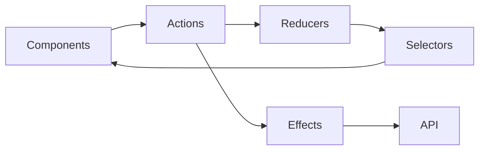

# Angular Signal Store Workshop

A practical Angular 19 workshop for comparing reducer/effect state management with signal-based application state. The Metro Art Explorer demonstrates authentication boundaries, asynchronous effects, entity selection, notifications, and testable UI state.

## Learning path

1. Trace actions, reducers, selectors, and effects in `src/app/features/metro/store`.
2. Identify server state, client state, and derived state.
3. Move derived state to computed signals and preserve explicit side effects.
4. Compare rendering, test ergonomics, and failure handling.



## Run the workshop

```bash
npm ci
npm start
npm test -- --watch=false --browsers=ChromeHeadless
npm run build
```

The repository uses a fake authentication service for local exercises. External Supabase and Pusher integrations must be configured with non-production credentials.

## Engineering focus

- Explicit async state and error paths
- Accessible, standalone Angular components
- Feature-local state boundaries
- Unit tests for stores, services, and user-facing components
- A migration path rather than a framework rewrite
